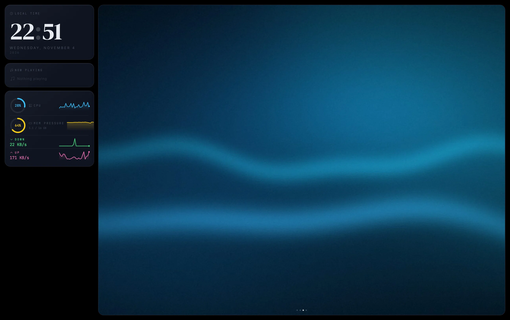

# Ambient Dashboard — Übersicht Widget

深色氛围副屏组件，显示时钟、正在播放的音乐专辑封面，以及系统状态。

| | |
|---|---|
| 状态 | v0.1.0 — 2026-03 完成，按个人使用需求实现，**不再主动开发** |
| 环境 | macOS + [Übersicht](https://tracesof.net/uebersicht/) |
| 依赖 | 无第三方库（bash + AppleScript + 系统自带 `python3`）；字体走 Google Fonts CDN，不可达时回退系统字体 |
| 背景 | 纯黑，不透视壁纸与桌面小组件（`SOLID_BG` 可切回模糊大图氛围背景） |
| 许可 | MIT |




## 预览内容

- 🕐 **大字时钟** — 数字每 8 秒刷新（受 `refreshFrequency` 控制），冒号是 CSS 每 1 秒呼吸动画
- 🎵 **Now Playing** — 专辑封面 + 歌名 + 歌手 + 专辑名 + 音频可视化条
  - 支持 Apple Music / Spotify
- 📊 **系统状态** — CPU / 内存 / 磁盘（带进度条）/ 网络收发量
- 🖼 **全屏轮播** — `slideshow/` 里的图片按 `SLIDE_SEC` 轮播（自带 4 张示例图）

---

## 安装

### 方式 A：脚本（推荐）

从 [Releases](../../releases/latest) 下载 `ambient-dashboard-v0.1.0.widget.zip`，解压后进入该目录：

```bash
bash install.sh
```

脚本会把组件复制到 `~/Library/Application Support/Übersicht/widgets/ambient-dashboard`，
已有的旧版本会先备份成 `ambient-dashboard.bak.<时间戳>`，不会静默覆盖。

### 方式 B：手动

```bash
cp -r ambient-dashboard \
  ~/Library/Application\ Support/Übersicht/widgets/
chmod +x \
  ~/Library/Application\ Support/Übersicht/widgets/ambient-dashboard/get-data.sh
```

---

## 首次运行：两次授权

缺任何一项，音乐区或封面就是空的 —— 这不是 bug。

- **完全磁盘访问权限**：系统设置 → 隐私与安全 → 完全磁盘访问权限 → 添加 **Übersicht**
  （读 Music 的专辑封面缓存需要）
- **自动化权限**：首次刷新时系统会弹窗「Übersicht 想要控制 System Events / Music」，必须点**允许**。
  漏点了到 系统设置 → 隐私与安全 → 自动化 里补勾。

然后：菜单栏 Übersicht 图标 → **Refresh All Widgets**。
定位到副屏：右键组件 → **Edit Position**，拖到副屏合适位置。

## 背景与轮播图

背景默认纯黑：组件盖满整屏，壁纸和 macOS 桌面小组件都不会透出来。这套半透明玻璃卡片的观感依赖黑色底衬，所以纯黑是默认值。

`slideshow/` 里有 4 张内置示例图（`example-01-aurora` / `02-ember` / `03-ocean` / `04-slate`），是程序生成的抽象渐变，可以直接换成你自己的照片：

```bash
cp ~/Pictures/*.jpg "$HOME/Library/Application Support/Übersicht/widgets/ambient-dashboard/slideshow/"
```

- 横向图观感最好（≥1600×900），竖图会被 `object-fit: cover` 裁切
- 放进去不用重装，Übersicht 下次刷新就会轮播
- 支持 jpg / jpeg / png / webp / gif / avif / heic / tiff / bmp

### 图片为什么不用 `file://`

Übersicht 不是用 `file://` 加载组件的，它在本地起一个 HTTP 服务（默认 `http://127.0.0.1:41416`）并把 widgets 目录挂在服务器根路径上。所以页面里的 `` 会被 WebKit 拦掉，静默渲染成空白——组件看起来一切正常，右侧大图就是不出图。

`get-data.sh` 因此输出两个字段：

| 字段 | 内容 | 谁用 |
|---|---|---|
| `images` | 绝对路径 `/Users/.../slideshow/a.jpg` | 脚本调试、别的工具 |
| `imageUrls` | 服务器相对路径 `/ambient-dashboard/slideshow/a.jpg` | 组件实际渲染用这个 |

专辑封面在 widgets 目录之外（`TMPDIR` 缓存），HTTP 服务够不到，所以改用 `artData`（`data:image/jpeg;base64,...` 内联）。封面按「歌手+歌名」缓存成 `art_<md5>.jpg`，切歌时不会闪上一首的图。


## 可调项

组件没有配置块，尺寸是全屏自适应（`position: fixed; inset: 0`），换显示器不用改任何东西。
真正常改的只有 `ambient-dashboard.jsx` 顶部两行：

| 位置 | 名字 | 默认 | 作用 |
|---|---|---|---|
| 第 9 行 | `refreshFrequency` | `8000` | 采集脚本执行间隔（ms）。时钟数字也受它控制——改成 `1000` 才是真正的秒级走字，代价是每秒起一个 `get-data.sh` 进程 |
| 第 10 行 | `SLIDE_SEC` | `20` | 轮播每张图停留的秒数 |
| 第 13 行 | `SOLID_BG` | `true` | `true` = 背景纯黑，完全遮住壁纸与桌面小组件；`false` = 用当前轮播图做模糊氛围背景（半透明，桌面会透出来） |

副屏分辨率不同也不影响布局；如果确实想让左侧卡片变宽，改 `leftPanel` 的 `width: 265px`。

## 颜色主题

在 `ambient-dashboard.jsx` 的 StatBar 调用处可修改各指标颜色：

| 指标 | 默认颜色 |
|------|---------|
| CPU  | 蓝色 `#4fc3f7` |
| 内存 | 绿色 `#81c784` |
| 磁盘 | 橙色 `#ffb74d` |
| 网络 | 紫色 `#ce93d8` |

---

## 故障排查

**专辑封面不显示？**
- 确保 Music.app 正在播放（Spotify 目前不支持封面抓取，仅显示文字信息）
- 手动运行脚本测试：`bash ~/Library/Application\ Support/Übersicht/widgets/ambient-dashboard/get-data.sh`

**CPU 数据一直为 0？**
- `top -l 2` 需要采样两次才有数据，脚本已处理，首次加载稍慢属正常

**组件不在副屏上？**
- 在 Übersicht 偏好设置中确认 "Display" 设置对应副屏编号

---

## 已知限制

- **Spotify 不抓封面**：Spotify 的 AppleScript 接口不暴露 artwork 数据，只能显示歌名/歌手/专辑文字。
- **`timeout` 依赖已移除**：macOS 不自带 `timeout`（那是 GNU coreutils）。脚本内置 `TO()` 包装，
  优先用 `timeout`，其次 `gtimeout`，都没有就直接执行，因此在原生 macOS 上也能跑。
- **临时文件**：历史曲线、内存采样、封面缓存在 `${TMPDIR}/uebersicht-ambient/` 下，
  不再写到 `/tmp` 固定文件名，避免多个实例互相覆盖。
- 只测过单显示器 + 一块副屏；多屏不同缩放比例下卡片位置需要手动拖。
- 字体（DM Serif Display / JetBrains Mono / Inter）从 `fonts.googleapis.com` 加载，大陆网络下通常拿不到，会回退到系统字体，大字号观感会明显不同。想固定观感就把字体文件放进 `assets/` 用 `@font-face` 引。

## 许可

MIT，见 [LICENSE](LICENSE)。
